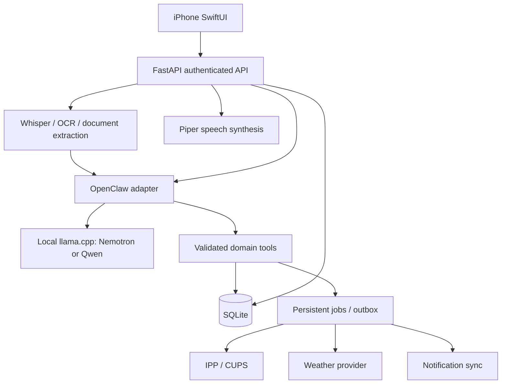

# Orin — architecture specification
Status: Proposed, pending owner approval. No implementation implied.

## Scope and invariants
Local-first personal assistant on Jetson Orin Nano 8GB, developed in Linux containers on a laptop. Native iPhone thin client supports voice, text, photos, files, share sheet, manual correction and accessible visual feedback. No paid AI APIs. No RAG without a demonstrated retrieval gap. Personal data survives model replacement. No arbitrary agent shell access. Python application logic; C++/CUDA native inference. Owner is architecture gatekeeper.

## System boundaries

The API is the only client-facing server. OpenClaw and inference endpoints remain private. Domain tools own all mutations; agent output is untrusted. Scheduler runs independently of inference. Start with a modular Python application and one scheduler worker, separate OpenClaw and inference processes only as required by runtime boundaries. No microservice fleet.

## Component contracts
- Model adapter: generate(messages, tool schemas, deadline) -> typed tool calls or text; model profile owns template, quantization, context and parsing. Reject malformed calls. Mock provider for tests; no cloud fallback.
- Agent adapter: handle(session, normalized input, allowed tools) -> response and action references. OpenClaw integration mechanism and version require a spike; do not assume its tool protocol.
- Speech: transcribe(audio, language hint) -> text; synthesize(text, voice) -> audio. whisper.cpp and Piper server-side. Start with bounded recordings, add streaming after profiling.
- Documents: extract(blob, media type) -> text, page/region provenance and confidence where available. OCR candidate Tesseract; evaluate alternatives on ARM64. Optional VLM loaded on demand only after measured need.
- Domain tools: typed input/output, explicit resource IDs, authorization, idempotency, optimistic version checks and structured errors. No direct SQL from agent. Reads precede ambiguous updates; ask clarification rather than guess.
- External adapters: weather forecast with timestamp and cache; print job submission with status; notification synchronization. Test doubles for all external effects.

## API proposal
Versioned JSON REST plus multipart uploads. POST /v1/interactions (text or attachment IDs, session ID, request ID); POST /v1/uploads; GET /v1/interactions/{id}; GET /v1/lists/{id}; GET /v1/reminders; POST /v1/actions/{id}/confirm; POST /v1/actions/{id}/undo. GET /healthz and /readyz. Interaction response includes status, transcript, reply, action IDs, confirmation requirements and optional audio URL. Long jobs return 202 and polling initially; streaming transport deferred. Manual list edits use the same domain tools. Errors carry stable codes, retryability and request ID. API schema versioned in OpenAPI. Proposed paths subject to review.

## Data and memory
SQLite on persistent local volume, foreign keys enabled, WAL, bounded busy timeout, schema migrations and explicit transactions. Proposed tables:
- lists(id, name, kind, version); items(id, list_id, label, quantity, unit, status, version, timestamps).
- sessions(id, timestamps); messages(id, session_id, role, content, created_at), retention configurable.
- actions(id, request_id, tool, status, before_state, after_state, created_at); unique idempotency key per operation.
- reminders(id, due_utc, timezone, recurrence, status, version); jobs(id, type, due_utc, attempts, lease_until, status, dedupe_key).
- attachments(id, content_hash, path, media_type, size, created_at); receipts(id, attachment_id, merchant, purchase_date, currency, total_minor, review_status); receipt_items(id, receipt_id, raw_label, normalized_label, quantity, amount_minor, provenance).
- preferences(key, value, provenance, updated_at); facts distinguish explicit user assertions from inferred suggestions.
Use UUIDs, UTC timestamps plus IANA timezone for user scheduling, integer minor units for money. File blobs stored outside DB with atomic rename, hash verification and orphan cleanup. SQLite FTS5 only when needed. No embeddings initially.
A mutation and its audit event/outbox entry commit together. Undo is a compensating transaction with version checks; never silently overwrite subsequent edits. External side effects may not be reversible. Deletion must cover derived records and retention-managed backups; audit logs must not retain deleted sensitive payloads indefinitely.

## Interaction flows
Shopping: fetch pending list, resolve item IDs, validate version, atomically apply changes, return actual committed state. 'Everything except bread' only affects the intended list snapshot; clarify ambiguous scope. 
Receipt: upload -> hash/deduplicate -> OCR -> structured extraction -> reconcile totals and line items -> propose matches -> user confirms uncertain or bulk changes -> commit purchase and list updates. A purchase is not proof of current pantry inventory. Treat document instructions as data, not commands.
Reminder: resolve timezone and ambiguous dates, persist schedule, synchronize iOS local notifications. Scheduler leases due jobs and retries recoverable failures; overdue policy explicit. iOS background delivery and remote changes are not guaranteed without a validated mechanism. Power outage cannot be covered by server alone.
Printing: render deterministic agenda, submit via IPP, track job ID. Do not blindly retry an ambiguous submission; report unknown status.
Weather: network-only feature, cached forecast marked stale; offline core unaffected.

## Security and privacy
Single-user initial scope. Pair device with revocable random credential stored in iOS Keychain; authenticated TLS for production, private LAN or optional VPN. No public port forwarding. Dev unauthenticated mode binds loopback only. Deny outbound access by default except explicit weather, updates and optional remote access. No arbitrary URL fetch or shell tool. Validate uploads by size, type and content; isolate parsers with time/resource limits, prevent path traversal and SSRF. Treat prompt injection as untrusted input; tool allowlists and confirmation policies enforced outside LLM. Confirm destructive/bulk actions, external side effects when ambiguous, and sensitive disclosures. Logs redact credentials and personal payloads. Backups encrypted where feasible; restore tested. No secrets, personal data or weights in Git.

## Portability and deployment
Same source and contracts across AMD64/ARM64; separate CPU and Jetson CUDA images pinned to compatible JetPack/L4T versions. Docker Compose base plus Jetson override; persistent data and model volumes outside containers. CPU mock tests in CI; real CPU inference tests opt-in; ARM64 build and on-device GPU smoke tests before release. Native iOS build requires macOS/Xcode. Pin dependencies and model checksums; verify licenses. Health checks, restart policies, graceful shutdown, database backup before migration, documented rollback (restore if migration irreversible). No automatic model downloads in production.

## Performance and reliability targets (unmeasured)
8GB shared RAM: provisional budget OS 1.6GB, model weights 2.7GB, speech 0.8GB, runtime/context 0.9GB, headroom 2GB. Not a guarantee; measure peak resident/shared memory and KV cache. One active LLM; cap context, queue inference and bound uploads. Avoid concurrent heavy OCR/VLM and LLM if memory pressure. Target simple commands p95 under 2s and contextual commands p95 under 5s after speech ends; report actual p50/p95, cold/warm and time to first token. Timer accuracy within 1s while server running. No silent lost writes; retry only idempotent operations. Daily consistent SQLite backups via backup API, restore drill, configurable retention. Monitor latency, queue depth, memory, disk and job failures without logging private content.

## Testing and acceptance
Unit tests for domain validation, timezones/DST, money, undo and deduplication. Integration tests for API, migrations, concurrent updates, restart persistence, scheduler crash recovery and mock external adapters. Scenario suite shared by Nemotron and Qwen: contextual lists, corrections, ambiguity, malformed calls, receipt duplicates, prompt injection and multi-step requests. Compare exact final state, false mutations, latency and peak memory. Security tests for unauthorized access, upload limits and network boundaries. iOS tests for reconnect, offline status, permissions and notification sync. Hardware acceptance on Jetson required before claiming performance. No application implementation or benchmarks completed by this proposal.

## Open decisions for gatekeeper
1. Modular monolith plus isolated runtime processes vs more services.
2. REST/multipart and polling first vs streaming from day one.
3. SQLite relational state plus event audit (not full event sourcing).
4. Local pairing/TLS first; optional VPN later.
5. Explicit confirmation for uncertain receipt matches and bulk changes.
6. Model and OpenClaw versions selected by compatibility spike and benchmark.
7. Notification behavior, iOS signing and retention policy require separate review.
